<h2 align="center">✨🌌 Hi there! 🌌✨</h2>

 

  <b>Fujimiya</b> 
  I'm a student engineer who loves making things. 🌙✨ 
  I build web apps and games.

 

  If you're interested in my work, feel free to check out my...

<h3 align="center">🔭✨ <a href="https://portfolio.fujimiya.dev/">Portfolio Website</a></h3>

  <i>A place where I show my <b>projects</b>, <b>skills</b>, and <b>experiences</b>. 🪐</i>

 

<h3 align="center">🌌 GitHub Activities</h3>

  
  

 

  ✨🪐 Always learning and trying new things! 🪐✨

<h3 align="center">Thank you for visiting! 🌙</h3>

 

  

